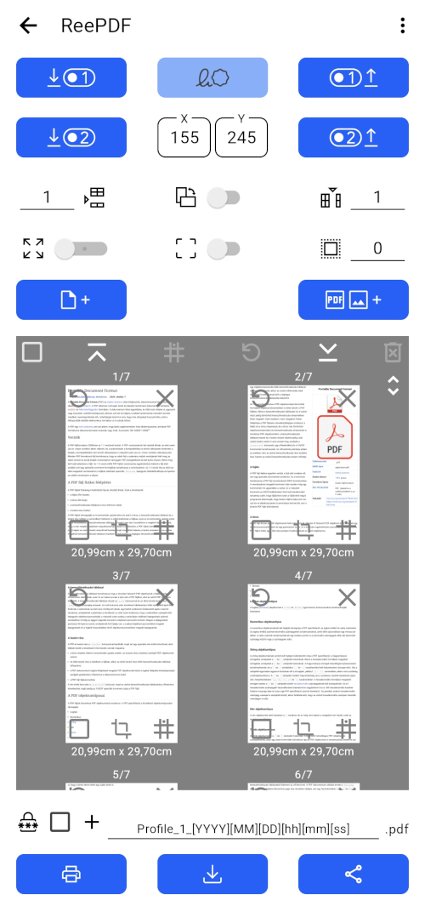
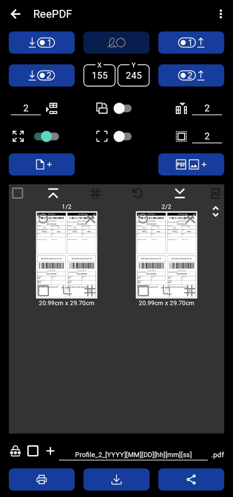
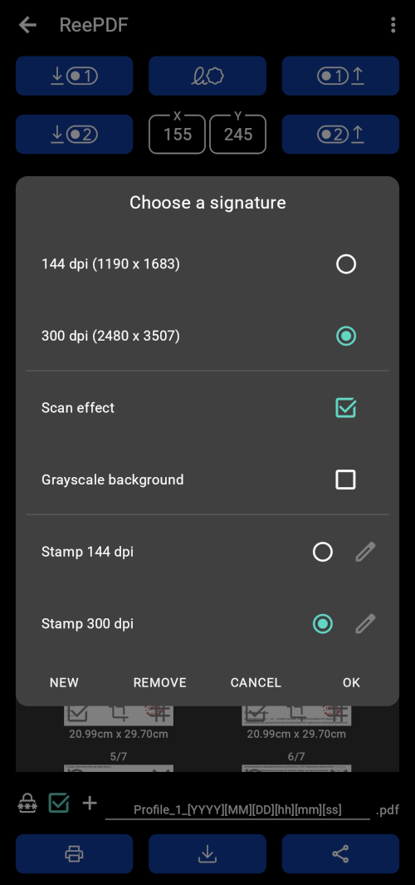

# ReePDF

Free and open-source PDF toolkit.  
It opens PDF documents and images, places several pages or cropped areas on one sheet (N-up),
crops, rotates, reorders and deletes pages, signs or stamps them, and prints, saves or shares the result.

Currently available for Android; desktop versions (Linux, Windows, macOS) are planned.

Everything runs locally on the device; the app has no internet access and collects no data.

We publish the source code so that others can use it, modify it and learn from it.


## Features

### Opening documents

- Open PDF files from the built-in file picker, the Android “Share” menu or “Open with”
- Share several PDFs at once; every new file is appended to the current page list
- Import JPG and PNG images (up to 8411 x 8411 px); each image becomes a page of its own size
- Open password-protected PDFs (the app asks for the password and asks again if it is wrong)
- Form fields and printable annotations are kept visible on the pages, hidden layers stay hidden
- Damaged PDFs are repaired automatically (MuPDF); if that fails, the app tries an earlier saved revision
  of the file
- Faulty page boxes, page contents and font encodings are repaired during import

### Page layout

- Place several pages or cropped areas on one A4 sheet: **Row** × **Column** grid (1–100 each),
  in portrait orientation, or in landscape orientation with the **Land.** (landscape) switch on
- **Margin** in millimeters around and between the cells (0–100 mm)
- **Scale** switch with three positions (tap to step through them, or drag the switch directly to any position):
  - off: pages are only reduced, never enlarged
  - middle: every page or cropped area is scaled to fill its cell, so small ones are enlarged
    for better print quality
  - right: measures the real content of the page (MuPDF), trims the empty border
    and fills the cell with the content only
- **Border**: draws a frame around every cell
- **Position on page**: aligns the page inside its cell to one of 9 positions (corners, edges, center),
  for all pages or for the selected ones
- **Free crop**: cut out any area of a page on a full-screen view of the page with two-finger zoom
  (drag the handles to resize the frame and the frame lines to move it), for a single page group or for all pages,
  and reset it at any time
- Rotate pages 90° to the left, one by one or all selected ones together
- Add an empty page to the end of the list, with the exact size of the first page
- The layout is rebuilt automatically whenever a setting changes
- Repeated processing (editing, changing the layout, opening a saved result again) does not add new nesting levels
  to the page content: a page that only places earlier content (a previous layout, saved edits) is drawn straight onto
  the sheet in one flat level, the edits of a page are kept next to its content instead of inside it, and the edits of
  earlier saves are merged into a single layer, so an edited page is no deeper than the same page without edits, its
  structure does not grow with every save, and the pages of large, repeatedly processed files stay fast and use little
  memory

### Page list

- Thumbnail grid of the output pages with page number and page size, fast scrolling and
  jump-to-start / jump-to-end buttons, even for documents with thousands of pages
- Reorder pages by drag and drop
- Select one, several or all pages; delete, rotate or position the selection in one step
- Every thumbnail has its own delete, rotate, position and crop buttons
- Tap a thumbnail to open the result in the built-in PDF viewer and editor

### Signature, stamp, watermark

- Add a PNG signature, stamp, logo or watermark to the selected pages
- Keep your own library of signature images (add new ones, remove old ones)
- Set the position in millimeters (X / Y); with a single page selected, tap the pencil icon
  to drag the signature to its place on a full-screen view of the page, with two-finger zoom
- Choose the resolution: 144 dpi or 300 dpi
- Optional **scan effect** and **grayscale background**
- The signed page is rasterized: the page content and the image become a single picture,
  so the signature is not a separate object that could simply be deleted from the PDF later.
  This is not a cryptographic protection: the picture itself can still be edited, and changes are not detected
- This saves you the usual routine of printing the document, signing it by hand, scanning it back and then
  sending the scanned copy, for example by e-mail: with the app you sign or stamp the document and share it
  right away

### Built-in PDF viewer and editor

- The app's own PDF viewer (MuPDF), on every supported Android version, fast even with tens of thousands of pages
- Continuous vertical pages, two-finger and double-tap zoom, fast scrollbar and page number
- Search (upper and lower case do not matter, accents do), text selection across pages and copying;
  with touch exploration on, the screen reader reads the text of the page
- Edit pages right in the viewer: pen and highlighter, each with its own color palette and five line widths;
  on text the highlighter follows the text lines
- Eraser (it also removes saved edits), remove the edits of the current page or of every page,
  undo and redo
- Saved edits stay on the pages even when the layout settings change later
- Edits stored in a file that was saved earlier and opened again become part of the page and
  cannot be removed separately

### Output

- **Print** with the Android print service
- **Save** to any location with the system file dialog
- **Share** with any app that accepts PDF files
- Optional password protection of the output (AES-256, revision 6, so a password-protected file is saved as
  PDF 2.0); the password has to be typed twice
- File name template with date and time tokens: `[YYYY]`, `[YY]`, `[MM]`, `[DD]`, `[hh]`, `[mm]`, `[ss]`;
  characters that are not allowed in file names are replaced

### Settings

- Two setting profiles, **Profile 1** and **Profile 2** (grid, margin, orientation, border, scale, position,
  crop, signature position (separately for portrait and landscape), resolution and effects, password
  protection, file name template), saved and loaded with one tap
- Export the settings to an XML file and import them again, for example on another device
- Light, dark or phone theme
- English and Hungarian user interface
- “About the app” window with the version number and links to this page, the privacy policy,
  the licenses, the source code and the contact address

### Long operations

- Progress window with percentage and a cancel button; canceling restores the previous state
- With notifications allowed, processing continues in the background with a notification (tapping it returns to the app), and the screen stays on while the app is open
- “Battery optimization” help in the menu, because some phones stop background work during long operations
- Built for very large documents: pages are processed in batches whose size adapts to the page content,
  to keep memory usage low
- Requires Android 8.0 or newer (API 26+)


## Screenshots

<p style="text-align: center;">
  
</p>

<p style="text-align: center;">
  
</p>

<p style="text-align: center;">
  
</p>


## Legal notice

The “signatures” created with this app **are not qualified electronic signatures and must not be
considered any kind of official, legally regulated signature**. The app is intended primarily for
personal / demonstration use, and you use it at your own risk.

The developer of the application **accepts no liability** for any legal consequences
or damages arising from the use of documents created in this way.


## Privacy

The app does not collect, store or transmit any personal data to a server. Details: `PRIVACY_POLICY.md`.


## Build / development

- Minimum SDK: 26
- Target / Compile SDK: 37
- Android Gradle Plugin: 9.5.x
- Java / Kotlin toolchain: 21

Typical build commands:

```bash
./gradlew assembleDebug
./gradlew assembleRelease
```

In Android Studio, simply open the project directory.

MuPDF does not come from Maven: the app uses its own build of MuPDF with twenty-two patches (the `mupdf` folder).
Gradle downloads the built AAR from the GitHub release `mupdf` of this repository automatically. To build it
yourself (Android NDK needed), run `bash mupdf/build.sh`; `mupdf/README.md` describes the patches, the build and
how to check for a newer MuPDF release (`bash mupdf/check_update.sh`).

Some unit tests use real-world PDF files: regression tests for earlier fixes look up specific files by name,
and the form and annotation import test uses every PDF in a `Forms_and_annotations` folder.
Put them into the `work/00_test_PDFs` folder, in any subfolders; `work/00_test_PDFs/README.md` lists the needed
files and where to get them. Without them these tests are skipped. The tests write their results into
`work/00_test_PDFs_work`. Both folders are described in their own README, and the files placed in them are never
committed.

### Release build and the R8 smoke test

The release build is shrunk and obfuscated with R8. iText, Xerces and MuPDF load some of their own classes by
name, which R8 cannot see; the rules in `app/proguard-rules.pro` keep exactly these classes. A broken rule does not
fail the build; it only shows up on the device, for example as a PDF that no longer opens. The shrunk app therefore
has to be tested after every library or Android Gradle Plugin update and before every release.

For this the project has an `r8check` build type: the same shrunk build as the release, signed with the debug key and
installed as a separate app (“ReePDF R8 test”, in Hungarian “ReePDF R8 próba”; `hu.reelee81.reepdf.r8check`)
next to the normal one.
It contains a hidden smoke test screen (`app/src/r8check`) that runs the PDF engine without the user interface:
it imports every PDF from its input folder, then rebuilds the layout (with Scale and Fit), crops, rotates, positions,
adds an empty page, reorders, deletes, signs (MuPDF) and saves with and without a password, and checks that
canceling an import restores the previous state. Every imported file is also opened the way the built-in screens
open it: the viewer (pages, zoomed tiles, search, text selection and copying), the thumbnails, the signature
placement and crop screens, and the editor (edits saved, erased and carried over into the page layout).

```bash
./gradlew :app:installR8check

# optional: your own test PDFs (any subfolders); without them only the generated test files are used
adb shell mkdir -p /sdcard/Android/data/hu.reelee81.reepdf.r8check/files/r8smoke
adb push work/00_test_PDFs/. /sdcard/Android/data/hu.reelee81.reepdf.r8check/files/r8smoke/

# run everything, or only the cancel check with: -e only cancel
adb shell am start -n hu.reelee81.reepdf.r8check/hu.reelee81.reepdf.R8SmokeActivity

# result: one OK / FAIL / SKIP line per step, and a DONE summary at the end
adb logcat -d -s ReePDFR8Smoke
adb pull /sdcard/Android/data/hu.reelee81.reepdf.r8check/files/r8smoke/result.txt
```

Keep the phone on the smoke test screen until the `DONE` line appears; with many large PDFs this can take a while.
Password-protected PDFs are skipped. A `FAIL` line with a message like “not found”, `ClassNotFoundException`,
`NoSuchMethodError` or a `NullPointerException` deep inside a library usually means a missing keep rule;
the obfuscated class names in the log can be looked up in `app/build/outputs/mapping/r8check/mapping.txt`.
Files that are broken on purpose fail in the normal debug build as well.


## License

The entire project (unless otherwise noted) is available under the terms of the

> **GNU Affero General Public License 3.0 or later**  
> (`AGPL-3.0-or-later`)

- A summary of the license is contained in the `LICENSE` and `NOTICE` files.
- The most important external dependencies and their licenses: `THIRD_PARTY_LICENSES.md`.

**Important:** the application uses the following libraries, which are themselves
available under AGPL-3.0 or a commercial license:

- **iText Core for Android (9.x)** – PDF processing and generation, password protection
- **MuPDF (Android/Java bindings, own build with patches, see `mupdf/`)** – the built-in PDF viewer and editor,
  thumbnails, rendering of signed pages, content bounds measurement, repair of damaged PDFs and password checking

If the AGPL terms are not suitable for the given project,
then you will need your own commercial licenses (iText: Apryse, MuPDF: Artifex).


## Open source

If you distribute the application or a modified version of it (for example in the Google Play Store),
the AGPL license requires you to make the complete, modified source code
publicly available as well (under an AGPL-compatible license).

The source code of this app: https://github.com/reelee81/ReePDF  
The app shows this link in the “About the app” window.


## Inspiration

The development of the application was inspired and bootstrapped by:

- [PDF N-Up Tool](https://github.com/Mollayo/PDF_N-Up_Tool) – An Android app to print multiple PDF pages per sheet.


## Contact

If you find a bug or would like to suggest a change, it is recommended to open a GitHub issue,
or fork the repository and send a Pull Request.

E-mail: reelee81@gmail.com
